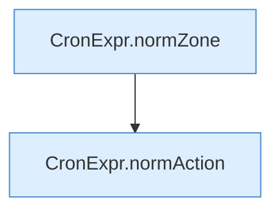

[[00 Start]] › [[Zeitplaene]] › [[Plan-Klassen]] › [[TaskDef]] › [[TaskDef.TaskDef]]

# TaskDef.TaskDef

`TaskDef.TaskDef(String id, boolean enabled, String cron, String timezone, String action, String command, String server)` [src/main/java/de/aichele/childlauncher/TaskDef.java:16–25](https://github.com/Sciddie/minecraft-serverhoster-plugin/blob/95b02b953b0b4c23673e900e021a7c3c844aa37d/src/main/java/de/aichele/childlauncher/TaskDef.java#L16-L25)



```knoten
CronExpr.normZone
  `normZone` in `CronExpr.java`.
CronExpr.normAction
  `normAction` in `CronExpr.java`.
```

- `TaskDef` in `src/main/java/de/aichele/childlauncher/TaskDef.java`
