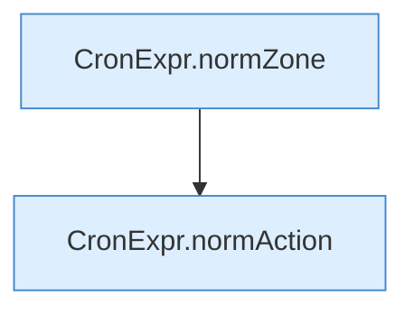

[[00 Start]] › [[Zeitplaene]] › [[Plan-Klassen]] › [[TaskDef]] › [[TaskDef.TaskDef]]

# TaskDef.TaskDef

`TaskDef.TaskDef(String id, boolean enabled, String cron, String timezone, String action, String command, String server)` [src/main/java/de/aichele/childlauncher/TaskDef.java:16–25](https://github.com/Sciddie/minecraft-serverhoster-plugin/blob/95b02b953b0b4c23673e900e021a7c3c844aa37d/src/main/java/de/aichele/childlauncher/TaskDef.java#L16-L25)



```knoten
CronExpr.normZone
  Dieser Teil macht hier einen einzelnen Schritt. Eine Ebene tiefer steht er genauer. `normZone` in `CronExpr.java`.
CronExpr.normAction
  Dieser Teil kümmert sich um die Tätigkeit. `normAction` in `CronExpr.java`.
```

> [!knoten]- Was die Blöcke tun
> - **CronExpr.normZone**: Dieser Teil macht hier einen einzelnen Schritt. Eine Ebene tiefer steht er genauer. `normZone` in `CronExpr.java`.
> - **CronExpr.normAction**: Dieser Teil kümmert sich um die Tätigkeit. `normAction` in `CronExpr.java`.

- Dieser Teil macht hier einen einzelnen Schritt. Eine Ebene tiefer steht er genauer.
- `TaskDef` in `src/main/java/de/aichele/childlauncher/TaskDef.java`
