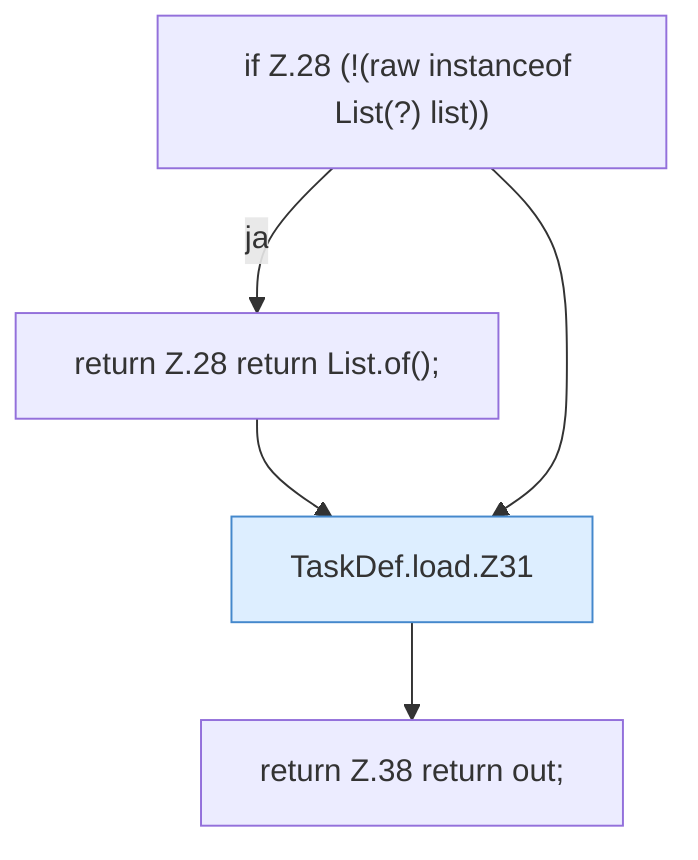

[[00 Start]] › [[Zeitplaene]] › [[Plan-Klassen]] › [[TaskDef]] › [[TaskDef.load]]

# TaskDef.load

`TaskDef.load(Object raw)` [src/main/java/de/aichele/childlauncher/TaskDef.java:27–39](https://github.com/Sciddie/minecraft-serverhoster-plugin/blob/95b02b953b0b4c23673e900e021a7c3c844aa37d/src/main/java/de/aichele/childlauncher/TaskDef.java#L27-L39)



```knoten
if Z.28 (!(raw instanceof List(?) list))
  Zeile 28: prüft `(!(raw instanceof List(?) list))`.
return Z.28 return List.of();
  Zeile 28: Rückgabe `return List.of();`.
TaskDef.load.Z31
  Fortsetzung des Ablaufs ab Zeile 31.
return Z.38 return out;
  Zeile 38: Rückgabe `return out;`.
```

- `load` in `src/main/java/de/aichele/childlauncher/TaskDef.java`
