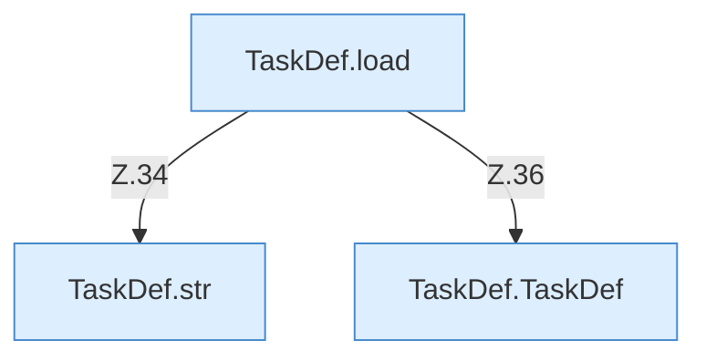

[[00 Start]] › [[Zeitplaene]] › [[Plan-Klassen]] › [[TaskDef]]

# TaskDef



```knoten
TaskDef.TaskDef
  Dieser Teil macht hier einen einzelnen Schritt. Eine Ebene tiefer steht er genauer. Im [[Glossar#Quelltext|Quelltext]] heißt das `TaskDef`.
TaskDef.load
  Dieser Teil lädt das. Im [[Glossar#Quelltext|Quelltext]] heißt das `load`.
TaskDef.str
  Dieser Teil macht hier einen einzelnen Schritt. Eine Ebene tiefer steht er genauer. Im [[Glossar#Quelltext|Quelltext]] heißt das `str`.
```

> [!knoten]- Was die Blöcke tun
> - **TaskDef.TaskDef**: Dieser Teil macht hier einen einzelnen Schritt. Eine Ebene tiefer steht er genauer. Im [[Glossar#Quelltext|Quelltext]] heißt das `TaskDef`.
> - **TaskDef.load**: Dieser Teil lädt das. Im [[Glossar#Quelltext|Quelltext]] heißt das `load`.
> - **TaskDef.str**: Dieser Teil macht hier einen einzelnen Schritt. Eine Ebene tiefer steht er genauer. Im [[Glossar#Quelltext|Quelltext]] heißt das `str`.

- Eine [[Glossar#Aufgabe|Aufgabe]] aus der älteren Liste.
