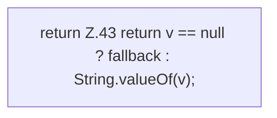

[[00 Start]] › [[Zeitplaene]] › [[Plan-Klassen]] › [[TaskDef]] › [[TaskDef.str]]

# TaskDef.str

`TaskDef.str(Map<?, ?> map, String key, String fallback)` [src/main/java/de/aichele/childlauncher/TaskDef.java:41–44](https://github.com/Sciddie/minecraft-serverhoster-plugin/blob/95b02b953b0b4c23673e900e021a7c3c844aa37d/src/main/java/de/aichele/childlauncher/TaskDef.java#L41-L44)



```knoten
return Z.43 return v == null ? fallback : String.valueOf(v);
  Zeile 43: Rückgabe `return v == null ? fallback : String.valueOf(v);`.
```

> [!knoten]- Was die Blöcke tun
> - **return Z.43 return v == null ? fallback : String.valueOf(v);**: Zeile 43: Rückgabe `return v == null ? fallback : String.valueOf(v);`.

- Dieser Teil macht hier einen einzelnen Schritt. Eine Ebene tiefer steht er genauer.
- `str` in `src/main/java/de/aichele/childlauncher/TaskDef.java`
