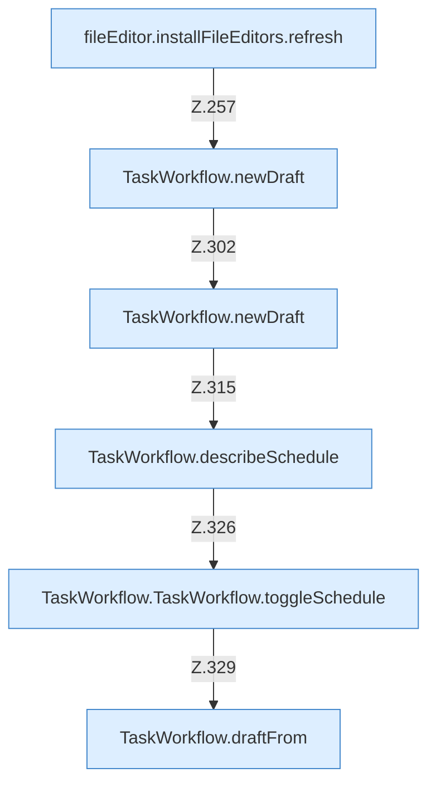

[[00 Start]] › [[Dashboard-UI]] › [[UI-Workflows]] › [[TaskWorkflow]] › [[TaskWorkflow.TaskWorkflow]] › [[TaskWorkflow.TaskWorkflow.Teil2.Calls254]]

# TaskWorkflow.TaskWorkflow.Teil2.Calls254



```knoten
fileEditor.installFileEditors.refresh
  Die [[Glossar#Bedienseite|Bedienseite]] lädt neu das. Lädt neu `refresh`. Ruft `editorFor`.
TaskWorkflow.newDraft
  Die [[Glossar#Bedienseite|Bedienseite]] macht hier einen einzelnen Schritt. Eine Ebene tiefer steht er genauer. `newDraft` in `TaskWorkflow.tsx`. Ruft `newId`.
TaskWorkflow.describeSchedule
  Die [[Glossar#Bedienseite|Bedienseite]] plant das. Beschreibt `describeSchedule`.
TaskWorkflow.TaskWorkflow.toggleSchedule
  Die [[Glossar#Bedienseite|Bedienseite]] schaltet um den [[Glossar#Zeitplan|Zeitplan]]. Schaltet um `toggleSchedule`. Ruft `dashboardRequest`, `jsonBody`, `refresh`.
TaskWorkflow.draftFrom
  Die [[Glossar#Bedienseite|Bedienseite]] kümmert sich um aus. Baut einen Entwurf `draftFrom`.
```

> [!knoten]- Was die Blöcke tun
> - **fileEditor.installFileEditors.refresh**: Die [[Glossar#Bedienseite|Bedienseite]] lädt neu das. Lädt neu `refresh`. Ruft `editorFor`.
> - **TaskWorkflow.newDraft**: Die [[Glossar#Bedienseite|Bedienseite]] macht hier einen einzelnen Schritt. Eine Ebene tiefer steht er genauer. `newDraft` in `TaskWorkflow.tsx`. Ruft `newId`.
> - **TaskWorkflow.describeSchedule**: Die [[Glossar#Bedienseite|Bedienseite]] plant das. Beschreibt `describeSchedule`.
> - **TaskWorkflow.TaskWorkflow.toggleSchedule**: Die [[Glossar#Bedienseite|Bedienseite]] schaltet um den [[Glossar#Zeitplan|Zeitplan]]. Schaltet um `toggleSchedule`. Ruft `dashboardRequest`, `jsonBody`, `refresh`.
> - **TaskWorkflow.draftFrom**: Die [[Glossar#Bedienseite|Bedienseite]] kümmert sich um aus. Baut einen Entwurf `draftFrom`.

- Weitere [[Glossar#Funktion|Funktionen]], die ab [[Glossar#Zeile|Zeile]] 254 aufgerufen werden.
- Fortsetzung von `TaskWorkflow.TaskWorkflow.Teil2`.
