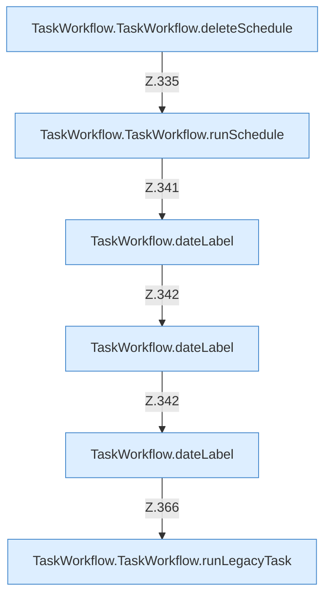

[[00 Start]] › [[Dashboard-UI]] › [[UI-Workflows]] › [[TaskWorkflow]] › [[TaskWorkflow.TaskWorkflow]] › [[TaskWorkflow.TaskWorkflow.Teil2.Calls332]]

# TaskWorkflow.TaskWorkflow.Teil2.Calls332



```knoten
TaskWorkflow.TaskWorkflow.deleteSchedule
  Die [[Glossar#Bedienseite|Bedienseite]] löscht den [[Glossar#Zeitplan|Zeitplan]]. Löscht `deleteSchedule`. Ruft `askBeforeDelete`, `dashboardRequest`, `refresh`.
TaskWorkflow.TaskWorkflow.runSchedule
  Die [[Glossar#Bedienseite|Bedienseite]] führt aus den [[Glossar#Zeitplan|Zeitplan]]. Führt aus `runSchedule`. Ruft `dashboardRequest`, `refresh`.
TaskWorkflow.dateLabel
  Die [[Glossar#Bedienseite|Bedienseite]] kümmert sich um die Beschriftung. `dateLabel` in `TaskWorkflow.tsx`.
TaskWorkflow.TaskWorkflow.runLegacyTask
  Die [[Glossar#Bedienseite|Bedienseite]] führt aus den alten Weg die [[Glossar#Aufgabe|Aufgabe]]. Führt aus `runLegacyTask`. Ruft `dashboardRequest`, `refresh`.
```

> [!knoten]- Was die Blöcke tun
> - **TaskWorkflow.TaskWorkflow.deleteSchedule**: Die [[Glossar#Bedienseite|Bedienseite]] löscht den [[Glossar#Zeitplan|Zeitplan]]. Löscht `deleteSchedule`. Ruft `askBeforeDelete`, `dashboardRequest`, `refresh`.
> - **TaskWorkflow.TaskWorkflow.runSchedule**: Die [[Glossar#Bedienseite|Bedienseite]] führt aus den [[Glossar#Zeitplan|Zeitplan]]. Führt aus `runSchedule`. Ruft `dashboardRequest`, `refresh`.
> - **TaskWorkflow.dateLabel**: Die [[Glossar#Bedienseite|Bedienseite]] kümmert sich um die Beschriftung. `dateLabel` in `TaskWorkflow.tsx`.
> - **TaskWorkflow.TaskWorkflow.runLegacyTask**: Die [[Glossar#Bedienseite|Bedienseite]] führt aus den alten Weg die [[Glossar#Aufgabe|Aufgabe]]. Führt aus `runLegacyTask`. Ruft `dashboardRequest`, `refresh`.

- Weitere [[Glossar#Funktion|Funktionen]], die ab [[Glossar#Zeile|Zeile]] 332 aufgerufen werden.
- Fortsetzung von `TaskWorkflow.TaskWorkflow.Teil2`.
