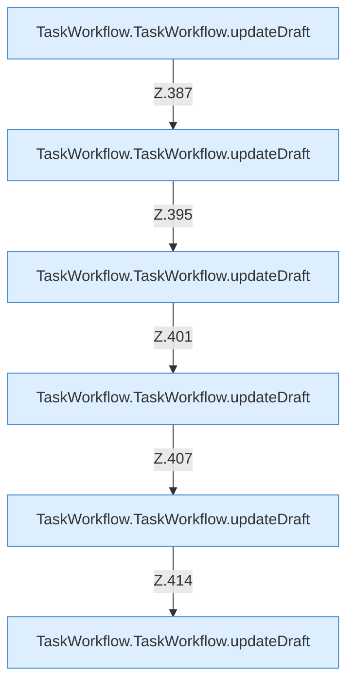

[[00 Start]] › [[Dashboard-UI]] › [[UI-Workflows]] › [[TaskWorkflow]] › [[TaskWorkflow.TaskWorkflow]] › [[TaskWorkflow.TaskWorkflow.Teil2.Calls384]]

# TaskWorkflow.TaskWorkflow.Teil2.Calls384

- Fortsetzung von `TaskWorkflow.TaskWorkflow.Teil2`, Quellreihenfolge.
