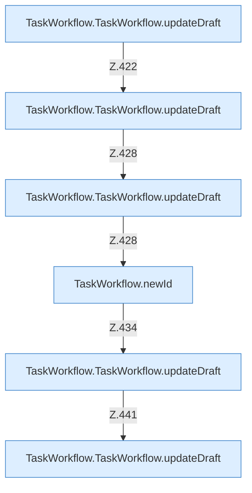

[[00 Start]] › [[Dashboard-UI]] › [[UI-Workflows]] › [[TaskWorkflow]] › [[TaskWorkflow.TaskWorkflow]] › [[TaskWorkflow.TaskWorkflow.Teil2.Calls420]]

# TaskWorkflow.TaskWorkflow.Teil2.Calls420



```knoten
TaskWorkflow.TaskWorkflow.updateDraft
  Die [[Glossar#Bedienseite|Bedienseite]] ändert hier einen Schritt. Eine Ebene tiefer steht er genauer. Aktualisiert `updateDraft`.
TaskWorkflow.newId
  Die [[Glossar#Bedienseite|Bedienseite]] kümmert sich um die Kennung. `newId` in `TaskWorkflow.tsx`.
```

> [!knoten]- Was die Blöcke tun
> - **TaskWorkflow.TaskWorkflow.updateDraft**: Die [[Glossar#Bedienseite|Bedienseite]] ändert hier einen Schritt. Eine Ebene tiefer steht er genauer. Aktualisiert `updateDraft`.
> - **TaskWorkflow.newId**: Die [[Glossar#Bedienseite|Bedienseite]] kümmert sich um die Kennung. `newId` in `TaskWorkflow.tsx`.

- Weitere [[Glossar#Funktion|Funktionen]], die ab [[Glossar#Zeile|Zeile]] 420 aufgerufen werden.
- Fortsetzung von `TaskWorkflow.TaskWorkflow.Teil2`.
