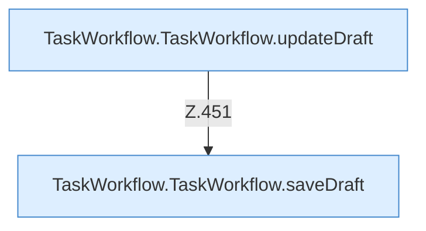

[[00 Start]] › [[Dashboard-UI]] › [[UI-Workflows]] › [[TaskWorkflow]] › [[TaskWorkflow.TaskWorkflow]] › [[TaskWorkflow.TaskWorkflow.Teil2.Calls444]]

# TaskWorkflow.TaskWorkflow.Teil2.Calls444



```knoten
TaskWorkflow.TaskWorkflow.updateDraft
  Aktualisiert `updateDraft`.
TaskWorkflow.TaskWorkflow.saveDraft
  Speichert `saveDraft`. Ruft `dashboardRequest`, `jsonBody`, `refresh`.
```

- Fortsetzung von `TaskWorkflow.TaskWorkflow.Teil2`, Quellreihenfolge.
