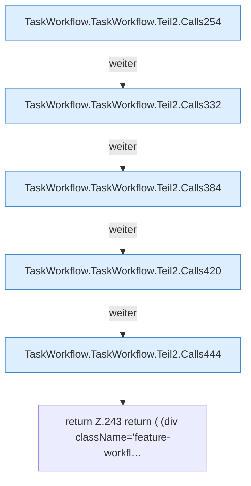

[[00 Start]] › [[Dashboard-UI]] › [[UI-Workflows]] › [[TaskWorkflow]] › [[TaskWorkflow.TaskWorkflow]] › [[TaskWorkflow.TaskWorkflow.Teil2]]

# TaskWorkflow.TaskWorkflow.Teil2



```knoten
TaskWorkflow.TaskWorkflow.Teil2.Calls254
  Weitere eigene Aufrufe ab Zeile 254.
TaskWorkflow.TaskWorkflow.Teil2.Calls332
  Weitere eigene Aufrufe ab Zeile 332.
TaskWorkflow.TaskWorkflow.Teil2.Calls384
  Weitere eigene Aufrufe ab Zeile 384.
TaskWorkflow.TaskWorkflow.Teil2.Calls420
  Weitere eigene Aufrufe ab Zeile 420.
TaskWorkflow.TaskWorkflow.Teil2.Calls444
  Weitere eigene Aufrufe ab Zeile 444.
return Z.243 return ( (div className='feature-workfl…
  Zeile 243: Rückgabe `return ( (div className='feature-workfl…`.
```

- Fortsetzung von `TaskWorkflow.TaskWorkflow`, Quellreihenfolge.
