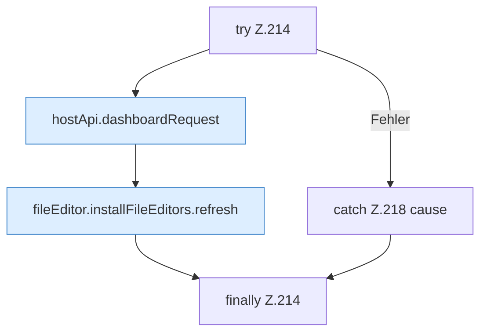

[[00 Start]] › [[Dashboard-UI]] › [[UI-Workflows]] › [[TaskWorkflow]] › [[TaskWorkflow.TaskWorkflow]] › [[TaskWorkflow.TaskWorkflow.deleteSchedule]] › [[TaskWorkflow.TaskWorkflow.deleteSchedule.Z214]]

# TaskWorkflow.TaskWorkflow.deleteSchedule.Z214

- Fortsetzung von `TaskWorkflow.TaskWorkflow.deleteSchedule`, Quellreihenfolge.
