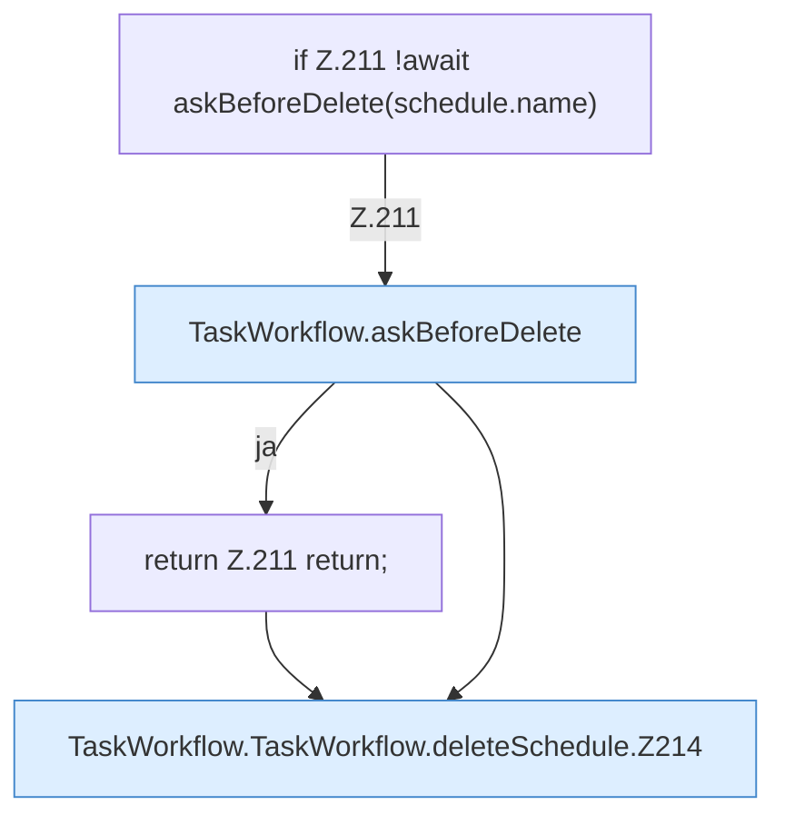

[[00 Start]] › [[Dashboard-UI]] › [[UI-Workflows]] › [[TaskWorkflow]] › [[TaskWorkflow.TaskWorkflow]] › [[TaskWorkflow.TaskWorkflow.deleteSchedule]]

# TaskWorkflow.TaskWorkflow.deleteSchedule

`TaskWorkflow.deleteSchedule(schedule: Schedule)` [ui/src/components/TaskWorkflow.tsx:210–223](https://github.com/Sciddie/minecraft-serverhoster-plugin/blob/95b02b953b0b4c23673e900e021a7c3c844aa37d/ui/src/components/TaskWorkflow.tsx#L210-L223)



```knoten
if Z.211 !await askBeforeDelete(schedule.name)
  Zeile 211: prüft `!await askBeforeDelete(schedule.name)`.
TaskWorkflow.askBeforeDelete
  Die [[Glossar#Bedienseite|Bedienseite]] macht hier einen einzelnen Schritt. Eine Ebene tiefer steht er genauer. Fragt nach `askBeforeDelete`.
return Z.211 return;
  Zeile 211: Rückgabe `return;`.
TaskWorkflow.TaskWorkflow.deleteSchedule.Z214
  Der Ablauf geht in [[Glossar#Zeile|Zeile]] 214 weiter. Eine Ebene tiefer steht er genauer. Fortsetzung des Ablaufs ab Zeile 214.
```

> [!knoten]- Was die Blöcke tun
> - **if Z.211 !await askBeforeDelete(schedule.name)**: Zeile 211: prüft `!await askBeforeDelete(schedule.name)`.
> - **TaskWorkflow.askBeforeDelete**: Die [[Glossar#Bedienseite|Bedienseite]] macht hier einen einzelnen Schritt. Eine Ebene tiefer steht er genauer. Fragt nach `askBeforeDelete`.
> - **return Z.211 return;**: Zeile 211: Rückgabe `return;`.
> - **TaskWorkflow.TaskWorkflow.deleteSchedule.Z214**: Der Ablauf geht in [[Glossar#Zeile|Zeile]] 214 weiter. Eine Ebene tiefer steht er genauer. Fortsetzung des Ablaufs ab Zeile 214.

- Die [[Glossar#Bedienseite|Bedienseite]] löscht den [[Glossar#Zeitplan|Zeitplan]].
- `deleteSchedule` in `ui/src/components/TaskWorkflow.tsx`
