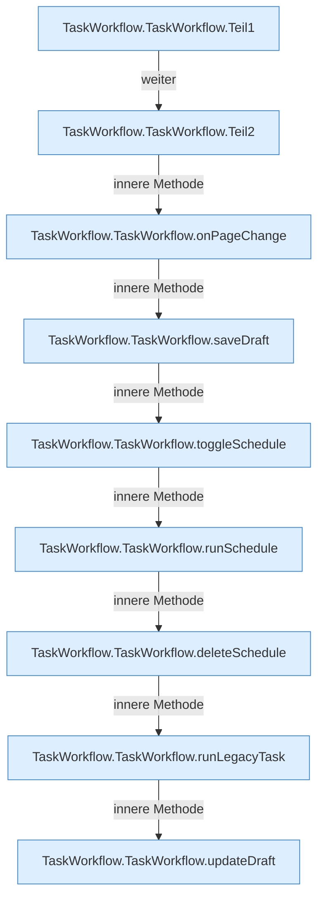

[[00 Start]] › [[Dashboard-UI]] › [[UI-Workflows]] › [[TaskWorkflow]] › [[TaskWorkflow.TaskWorkflow]]

# TaskWorkflow.TaskWorkflow

`TaskWorkflow.TaskWorkflow()` [ui/src/components/TaskWorkflow.tsx:117–460](https://github.com/Sciddie/minecraft-serverhoster-plugin/blob/95b02b953b0b4c23673e900e021a7c3c844aa37d/ui/src/components/TaskWorkflow.tsx#L117-L460)



```knoten
TaskWorkflow.TaskWorkflow.Teil1
  Abschnitt 1 dieses Ablaufs, in Quellreihenfolge.
TaskWorkflow.TaskWorkflow.Teil2
  Abschnitt 2 dieses Ablaufs, in Quellreihenfolge.
TaskWorkflow.TaskWorkflow.onPageChange
  Reagiert `onPageChange`. Ruft `refresh`.
TaskWorkflow.TaskWorkflow.saveDraft
  Speichert `saveDraft`. Ruft `dashboardRequest`, `jsonBody`, `refresh`.
TaskWorkflow.TaskWorkflow.toggleSchedule
  Schaltet um `toggleSchedule`. Ruft `dashboardRequest`, `jsonBody`, `refresh`.
TaskWorkflow.TaskWorkflow.runSchedule
  Führt aus `runSchedule`. Ruft `dashboardRequest`, `refresh`.
TaskWorkflow.TaskWorkflow.deleteSchedule
  Löscht `deleteSchedule`. Ruft `askBeforeDelete`, `dashboardRequest`, `refresh`.
TaskWorkflow.TaskWorkflow.runLegacyTask
  Führt aus `runLegacyTask`. Ruft `dashboardRequest`, `refresh`.
TaskWorkflow.TaskWorkflow.updateDraft
  Aktualisiert `updateDraft`.
```

- `TaskWorkflow` in `ui/src/components/TaskWorkflow.tsx`
