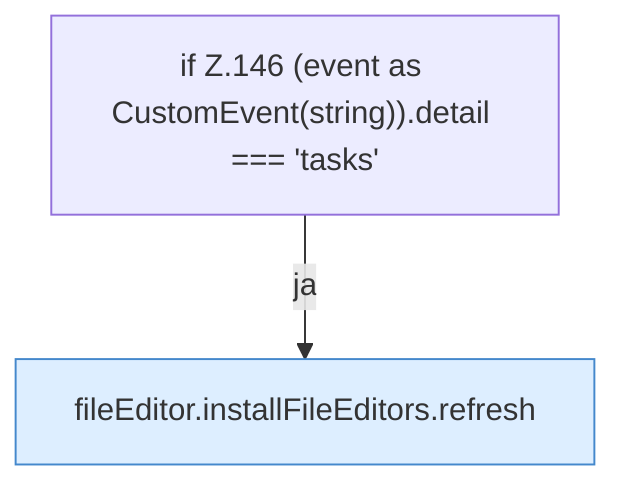

[[00 Start]] › [[Dashboard-UI]] › [[UI-Workflows]] › [[TaskWorkflow]] › [[TaskWorkflow.TaskWorkflow]] › [[TaskWorkflow.TaskWorkflow.onPageChange]]

# TaskWorkflow.TaskWorkflow.onPageChange

`TaskWorkflow.onPageChange(event: Event)` [ui/src/components/TaskWorkflow.tsx:145–147](https://github.com/Sciddie/minecraft-serverhoster-plugin/blob/95b02b953b0b4c23673e900e021a7c3c844aa37d/ui/src/components/TaskWorkflow.tsx#L145-L147)



```knoten
if Z.146 (event as CustomEvent(string)).detail === 'tasks'
  Zeile 146: prüft `(event as CustomEvent(string)).detail === 'tasks'`.
fileEditor.installFileEditors.refresh
  Lädt neu `refresh`. Ruft `editorFor`.
```

- `onPageChange` in `ui/src/components/TaskWorkflow.tsx`
