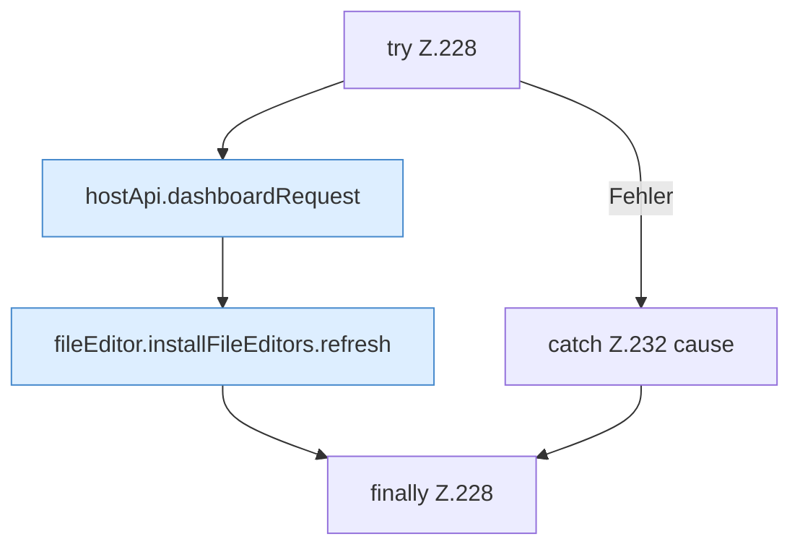

[[00 Start]] › [[Dashboard-UI]] › [[UI-Workflows]] › [[TaskWorkflow]] › [[TaskWorkflow.TaskWorkflow]] › [[TaskWorkflow.TaskWorkflow.runLegacyTask]] › [[TaskWorkflow.TaskWorkflow.runLegacyTask.Z228]]

# TaskWorkflow.TaskWorkflow.runLegacyTask.Z228



```knoten
try Z.228
  Zeile 228: Versuch. Der Fehlerpfad geht in catch.
hostApi.dashboardRequest
  `dashboardRequest` in `hostApi.ts`.
fileEditor.installFileEditors.refresh
  Lädt neu `refresh`. Ruft `editorFor`.
catch Z.232 cause
  Zeile 232: fängt cause.
finally Z.228
  Läuft danach immer, auch nach einem Fehler.
```

- Fortsetzung von `TaskWorkflow.TaskWorkflow.runLegacyTask`, Quellreihenfolge.
