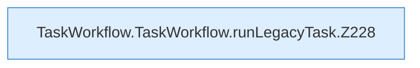

[[00 Start]] › [[Dashboard-UI]] › [[UI-Workflows]] › [[TaskWorkflow]] › [[TaskWorkflow.TaskWorkflow]] › [[TaskWorkflow.TaskWorkflow.runLegacyTask]]

# TaskWorkflow.TaskWorkflow.runLegacyTask

`TaskWorkflow.runLegacyTask(task: LegacyTask)` [ui/src/components/TaskWorkflow.tsx:225–237](https://github.com/Sciddie/minecraft-serverhoster-plugin/blob/95b02b953b0b4c23673e900e021a7c3c844aa37d/ui/src/components/TaskWorkflow.tsx#L225-L237)



```knoten
TaskWorkflow.TaskWorkflow.runLegacyTask.Z228
  Fortsetzung des Ablaufs ab Zeile 228.
```

- `runLegacyTask` in `ui/src/components/TaskWorkflow.tsx`
