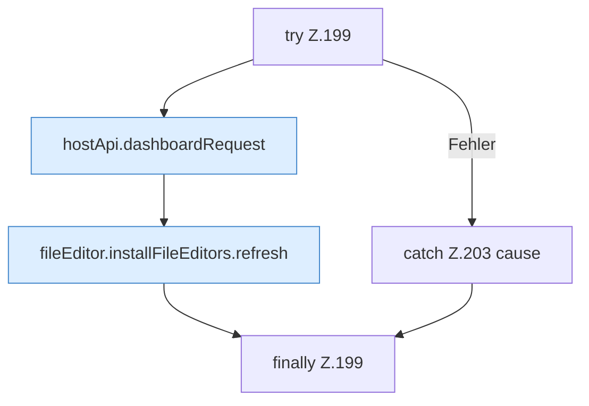

[[00 Start]] › [[Dashboard-UI]] › [[UI-Workflows]] › [[TaskWorkflow]] › [[TaskWorkflow.TaskWorkflow]] › [[TaskWorkflow.TaskWorkflow.runSchedule]] › [[TaskWorkflow.TaskWorkflow.runSchedule.Z199]]

# TaskWorkflow.TaskWorkflow.runSchedule.Z199



```knoten
try Z.199
  Zeile 199: Versuch. Der Fehlerpfad geht in catch.
hostApi.dashboardRequest
  `dashboardRequest` in `hostApi.ts`.
fileEditor.installFileEditors.refresh
  Lädt neu `refresh`. Ruft `editorFor`.
catch Z.203 cause
  Zeile 203: fängt cause.
finally Z.199
  Läuft danach immer, auch nach einem Fehler.
```

- Fortsetzung von `TaskWorkflow.TaskWorkflow.runSchedule`, Quellreihenfolge.
