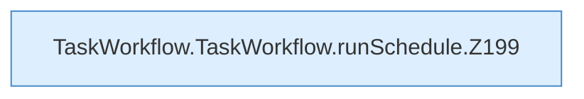

[[00 Start]] › [[Dashboard-UI]] › [[UI-Workflows]] › [[TaskWorkflow]] › [[TaskWorkflow.TaskWorkflow]] › [[TaskWorkflow.TaskWorkflow.runSchedule]]

# TaskWorkflow.TaskWorkflow.runSchedule

`TaskWorkflow.runSchedule(schedule: Schedule)` [ui/src/components/TaskWorkflow.tsx:196–208](https://github.com/Sciddie/minecraft-serverhoster-plugin/blob/95b02b953b0b4c23673e900e021a7c3c844aa37d/ui/src/components/TaskWorkflow.tsx#L196-L208)



```knoten
TaskWorkflow.TaskWorkflow.runSchedule.Z199
  Fortsetzung des Ablaufs ab Zeile 199.
```

- `runSchedule` in `ui/src/components/TaskWorkflow.tsx`
