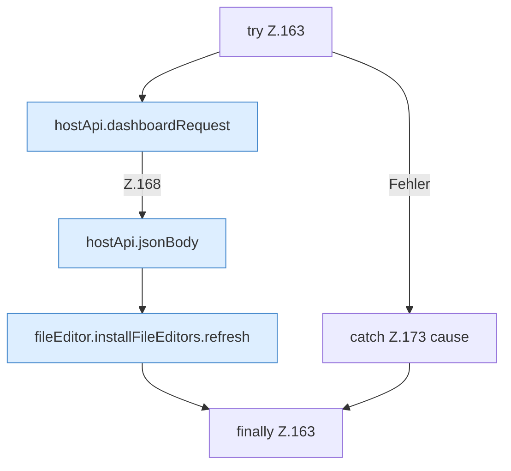

[[00 Start]] › [[Dashboard-UI]] › [[UI-Workflows]] › [[TaskWorkflow]] › [[TaskWorkflow.TaskWorkflow]] › [[TaskWorkflow.TaskWorkflow.saveDraft]] › [[TaskWorkflow.TaskWorkflow.saveDraft.Z163]]

# TaskWorkflow.TaskWorkflow.saveDraft.Z163



```knoten
try Z.163
  Zeile 163: Versuch. Der Fehlerpfad geht in catch.
hostApi.dashboardRequest
  Schickt von der [[Glossar#Bedienseite|Bedienseite]] eine Anfrage an das [[Glossar#Plugin|Plugin]]. `dashboardRequest` in `hostApi.ts`.
hostApi.jsonBody
  Baut den Text, den die [[Glossar#Bedienseite|Bedienseite]] als Auftrag mitschickt. Antwortet mit JSON `jsonBody`.
fileEditor.installFileEditors.refresh
  Die [[Glossar#Bedienseite|Bedienseite]] lädt neu das. Lädt neu `refresh`. Ruft `editorFor`.
catch Z.173 cause
  Zeile 173: fängt cause.
finally Z.163
  Läuft danach immer, auch nach einem Fehler.
```

> [!knoten]- Was die Blöcke tun
> - **try Z.163**: Zeile 163: Versuch. Der Fehlerpfad geht in catch.
> - **hostApi.dashboardRequest**: Schickt von der [[Glossar#Bedienseite|Bedienseite]] eine Anfrage an das [[Glossar#Plugin|Plugin]]. `dashboardRequest` in `hostApi.ts`.
> - **hostApi.jsonBody**: Baut den Text, den die [[Glossar#Bedienseite|Bedienseite]] als Auftrag mitschickt. Antwortet mit JSON `jsonBody`.
> - **fileEditor.installFileEditors.refresh**: Die [[Glossar#Bedienseite|Bedienseite]] lädt neu das. Lädt neu `refresh`. Ruft `editorFor`.
> - **catch Z.173 cause**: Zeile 173: fängt cause.
> - **finally Z.163**: Läuft danach immer, auch nach einem Fehler.

- Der Ablauf geht in [[Glossar#Zeile|Zeile]] 163 weiter. Eine Ebene tiefer steht er genauer.
- Fortsetzung von `TaskWorkflow.TaskWorkflow.saveDraft`.
