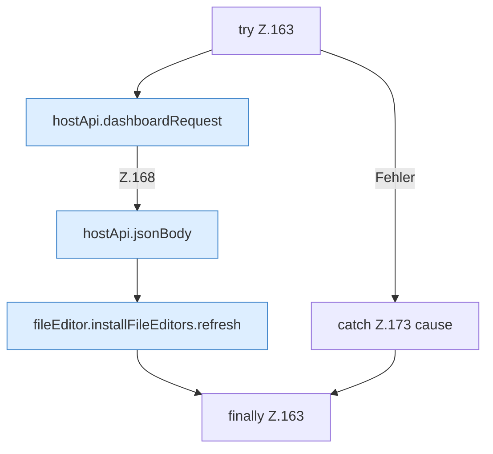

[[00 Start]] › [[Dashboard-UI]] › [[UI-Workflows]] › [[TaskWorkflow]] › [[TaskWorkflow.TaskWorkflow]] › [[TaskWorkflow.TaskWorkflow.saveDraft]] › [[TaskWorkflow.TaskWorkflow.saveDraft.Z163]]

# TaskWorkflow.TaskWorkflow.saveDraft.Z163

- Fortsetzung von `TaskWorkflow.TaskWorkflow.saveDraft`, Quellreihenfolge.
