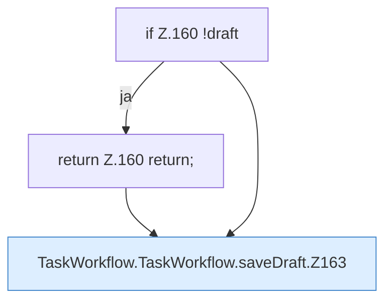

[[00 Start]] › [[Dashboard-UI]] › [[UI-Workflows]] › [[TaskWorkflow]] › [[TaskWorkflow.TaskWorkflow]] › [[TaskWorkflow.TaskWorkflow.saveDraft]]

# TaskWorkflow.TaskWorkflow.saveDraft

`TaskWorkflow.saveDraft()` [ui/src/components/TaskWorkflow.tsx:159–178](https://github.com/Sciddie/minecraft-serverhoster-plugin/blob/95b02b953b0b4c23673e900e021a7c3c844aa37d/ui/src/components/TaskWorkflow.tsx#L159-L178)



```knoten
if Z.160 !draft
  Zeile 160: prüft `!draft`.
return Z.160 return;
  Zeile 160: Rückgabe `return;`.
TaskWorkflow.TaskWorkflow.saveDraft.Z163
  Der Ablauf geht in [[Glossar#Zeile|Zeile]] 163 weiter. Eine Ebene tiefer steht er genauer. Fortsetzung des Ablaufs ab Zeile 163.
```

> [!knoten]- Was die Blöcke tun
> - **if Z.160 !draft**: Zeile 160: prüft `!draft`.
> - **return Z.160 return;**: Zeile 160: Rückgabe `return;`.
> - **TaskWorkflow.TaskWorkflow.saveDraft.Z163**: Der Ablauf geht in [[Glossar#Zeile|Zeile]] 163 weiter. Eine Ebene tiefer steht er genauer. Fortsetzung des Ablaufs ab Zeile 163.

- Die [[Glossar#Bedienseite|Bedienseite]] speichert hier einen Schritt. Eine Ebene tiefer steht er genauer.
- `saveDraft` in `ui/src/components/TaskWorkflow.tsx`
