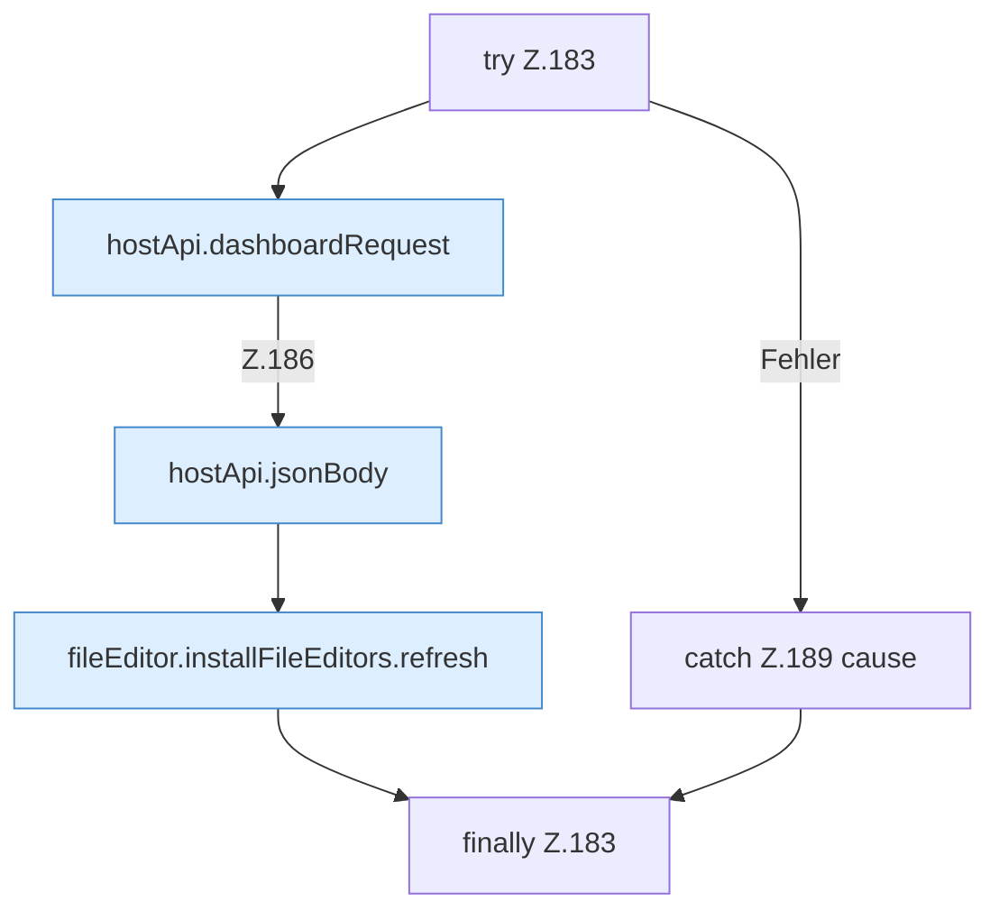

[[00 Start]] › [[Dashboard-UI]] › [[UI-Workflows]] › [[TaskWorkflow]] › [[TaskWorkflow.TaskWorkflow]] › [[TaskWorkflow.TaskWorkflow.toggleSchedule]] › [[TaskWorkflow.TaskWorkflow.toggleSchedule.Z183]]

# TaskWorkflow.TaskWorkflow.toggleSchedule.Z183

- Fortsetzung von `TaskWorkflow.TaskWorkflow.toggleSchedule`, Quellreihenfolge.
