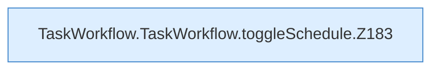

[[00 Start]] › [[Dashboard-UI]] › [[UI-Workflows]] › [[TaskWorkflow]] › [[TaskWorkflow.TaskWorkflow]] › [[TaskWorkflow.TaskWorkflow.toggleSchedule]]

# TaskWorkflow.TaskWorkflow.toggleSchedule

`TaskWorkflow.toggleSchedule(schedule: Schedule)` [ui/src/components/TaskWorkflow.tsx:180–194](https://github.com/Sciddie/minecraft-serverhoster-plugin/blob/95b02b953b0b4c23673e900e021a7c3c844aa37d/ui/src/components/TaskWorkflow.tsx#L180-L194)



```knoten
TaskWorkflow.TaskWorkflow.toggleSchedule.Z183
  Der Ablauf geht in [[Glossar#Zeile|Zeile]] 183 weiter. Eine Ebene tiefer steht er genauer. Fortsetzung des Ablaufs ab Zeile 183.
```

> [!knoten]- Was die Blöcke tun
> - **TaskWorkflow.TaskWorkflow.toggleSchedule.Z183**: Der Ablauf geht in [[Glossar#Zeile|Zeile]] 183 weiter. Eine Ebene tiefer steht er genauer. Fortsetzung des Ablaufs ab Zeile 183.

- Die [[Glossar#Bedienseite|Bedienseite]] schaltet um den [[Glossar#Zeitplan|Zeitplan]].
- `toggleSchedule` in `ui/src/components/TaskWorkflow.tsx`
