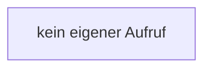

[[00 Start]] › [[Dashboard-UI]] › [[UI-Workflows]] › [[TaskWorkflow]] › [[TaskWorkflow.TaskWorkflow]] › [[TaskWorkflow.TaskWorkflow.updateDraft]]

# TaskWorkflow.TaskWorkflow.updateDraft

`TaskWorkflow.updateDraft(update: Partial<ScheduleDraft>)` [ui/src/components/TaskWorkflow.tsx:239–241](https://github.com/Sciddie/minecraft-serverhoster-plugin/blob/95b02b953b0b4c23673e900e021a7c3c844aa37d/ui/src/components/TaskWorkflow.tsx#L239-L241)



```knoten
kein eigener Aufruf
  In diesem Stück gibt es keinen weiteren eigenen Aufruf.
```

> [!knoten]- Was die Blöcke tun
> - **kein eigener Aufruf**: In diesem Stück gibt es keinen weiteren eigenen Aufruf.

- Die [[Glossar#Bedienseite|Bedienseite]] ändert hier einen Schritt. Eine Ebene tiefer steht er genauer.
- `updateDraft` in `ui/src/components/TaskWorkflow.tsx`
