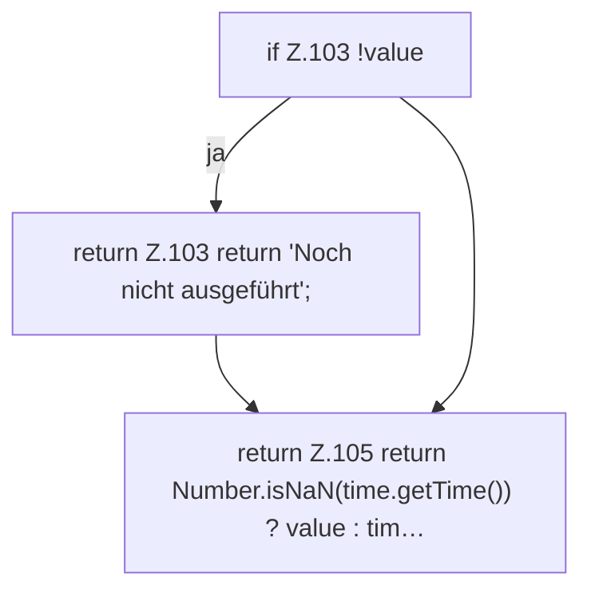

[[00 Start]] › [[Dashboard-UI]] › [[UI-Workflows]] › [[TaskWorkflow]] › [[TaskWorkflow.dateLabel]]

# TaskWorkflow.dateLabel

`TaskWorkflow.dateLabel(value: string)` [ui/src/components/TaskWorkflow.tsx:102–106](https://github.com/Sciddie/minecraft-serverhoster-plugin/blob/95b02b953b0b4c23673e900e021a7c3c844aa37d/ui/src/components/TaskWorkflow.tsx#L102-L106)

- `dateLabel` in `ui/src/components/TaskWorkflow.tsx`
