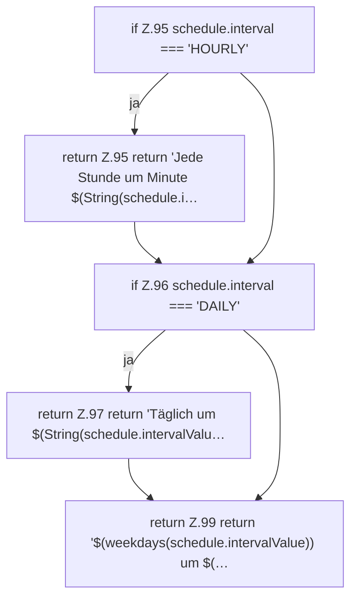

[[00 Start]] › [[Dashboard-UI]] › [[UI-Workflows]] › [[TaskWorkflow]] › [[TaskWorkflow.describeSchedule]]

# TaskWorkflow.describeSchedule

`TaskWorkflow.describeSchedule(schedule: Schedule)` [ui/src/components/TaskWorkflow.tsx:94–100](https://github.com/Sciddie/minecraft-serverhoster-plugin/blob/95b02b953b0b4c23673e900e021a7c3c844aa37d/ui/src/components/TaskWorkflow.tsx#L94-L100)



```knoten
if Z.95 schedule.interval === 'HOURLY'
  Zeile 95: prüft `schedule.interval === 'HOURLY'`.
return Z.95 return 'Jede Stunde um Minute $(String(schedule.i…
  Zeile 95: Rückgabe `return 'Jede Stunde um Minute $(String(schedule.i…`.
if Z.96 schedule.interval === 'DAILY'
  Zeile 96: prüft `schedule.interval === 'DAILY'`.
return Z.97 return 'Täglich um $(String(schedule.intervalValu…
  Zeile 97: Rückgabe `return 'Täglich um $(String(schedule.intervalValu…`.
return Z.99 return '$(weekdays(schedule.intervalValue)) um $(…
  Zeile 99: Rückgabe `return '$(weekdays(schedule.intervalValue)) um $(…`.
```

- `describeSchedule` in `ui/src/components/TaskWorkflow.tsx`
