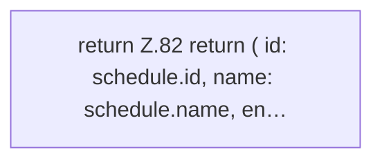

[[00 Start]] › [[Dashboard-UI]] › [[UI-Workflows]] › [[TaskWorkflow]] › [[TaskWorkflow.draftFrom]]

# TaskWorkflow.draftFrom

`TaskWorkflow.draftFrom(schedule: Schedule)` [ui/src/components/TaskWorkflow.tsx:81–92](https://github.com/Sciddie/minecraft-serverhoster-plugin/blob/95b02b953b0b4c23673e900e021a7c3c844aa37d/ui/src/components/TaskWorkflow.tsx#L81-L92)



```knoten
return Z.82 return ( id: schedule.id, name: schedule.name, en…
  Zeile 82: Rückgabe `return ( id: schedule.id, name: schedule.name, en…`.
```

- `draftFrom` in `ui/src/components/TaskWorkflow.tsx`
