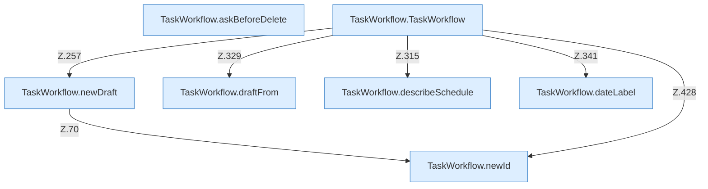

[[00 Start]] › [[Dashboard-UI]] › [[UI-Workflows]] › [[TaskWorkflow]]

# TaskWorkflow



```knoten
TaskWorkflow.newId
  `newId` in `TaskWorkflow.tsx`.
TaskWorkflow.newDraft
  `newDraft` in `TaskWorkflow.tsx`. Ruft `newId`.
TaskWorkflow.draftFrom
  Baut einen Entwurf `draftFrom`.
TaskWorkflow.describeSchedule
  Beschreibt `describeSchedule`.
TaskWorkflow.dateLabel
  `dateLabel` in `TaskWorkflow.tsx`.
TaskWorkflow.askBeforeDelete
  Fragt nach `askBeforeDelete`.
TaskWorkflow.TaskWorkflow
  `TaskWorkflow` in `TaskWorkflow.tsx`. Ruft `dashboardRequest`, `refresh`, `newDraft`.
```


