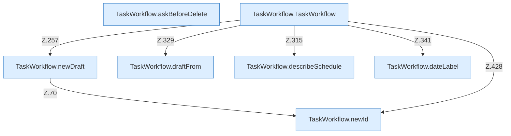

[[00 Start]] › [[Dashboard-UI]] › [[UI-Workflows]] › [[TaskWorkflow]]

# TaskWorkflow



```knoten
TaskWorkflow.newId
  Die [[Glossar#Bedienseite|Bedienseite]] kümmert sich um die Kennung. Im [[Glossar#Quelltext|Quelltext]] heißt das `newId`.
TaskWorkflow.newDraft
  Die [[Glossar#Bedienseite|Bedienseite]] macht hier einen einzelnen Schritt. Eine Ebene tiefer steht er genauer. Im [[Glossar#Quelltext|Quelltext]] heißt das `newDraft`.
TaskWorkflow.draftFrom
  Die [[Glossar#Bedienseite|Bedienseite]] kümmert sich um aus. Im [[Glossar#Quelltext|Quelltext]] heißt das `draftFrom`.
TaskWorkflow.describeSchedule
  Die [[Glossar#Bedienseite|Bedienseite]] plant das. Im [[Glossar#Quelltext|Quelltext]] heißt das `describeSchedule`.
TaskWorkflow.dateLabel
  Die [[Glossar#Bedienseite|Bedienseite]] kümmert sich um die Beschriftung. Im [[Glossar#Quelltext|Quelltext]] heißt das `dateLabel`.
TaskWorkflow.askBeforeDelete
  Die [[Glossar#Bedienseite|Bedienseite]] macht hier einen einzelnen Schritt. Eine Ebene tiefer steht er genauer. Im [[Glossar#Quelltext|Quelltext]] heißt das `askBeforeDelete`.
TaskWorkflow.TaskWorkflow
  Die [[Glossar#Bedienseite|Bedienseite]] kümmert sich um den Ablauf. Im [[Glossar#Quelltext|Quelltext]] heißt das `TaskWorkflow`.
```

> [!knoten]- Was die Blöcke tun
> - **TaskWorkflow.newId**: Die [[Glossar#Bedienseite|Bedienseite]] kümmert sich um die Kennung. Im [[Glossar#Quelltext|Quelltext]] heißt das `newId`.
> - **TaskWorkflow.newDraft**: Die [[Glossar#Bedienseite|Bedienseite]] macht hier einen einzelnen Schritt. Eine Ebene tiefer steht er genauer. Im [[Glossar#Quelltext|Quelltext]] heißt das `newDraft`.
> - **TaskWorkflow.draftFrom**: Die [[Glossar#Bedienseite|Bedienseite]] kümmert sich um aus. Im [[Glossar#Quelltext|Quelltext]] heißt das `draftFrom`.
> - **TaskWorkflow.describeSchedule**: Die [[Glossar#Bedienseite|Bedienseite]] plant das. Im [[Glossar#Quelltext|Quelltext]] heißt das `describeSchedule`.
> - **TaskWorkflow.dateLabel**: Die [[Glossar#Bedienseite|Bedienseite]] kümmert sich um die Beschriftung. Im [[Glossar#Quelltext|Quelltext]] heißt das `dateLabel`.
> - **TaskWorkflow.askBeforeDelete**: Die [[Glossar#Bedienseite|Bedienseite]] macht hier einen einzelnen Schritt. Eine Ebene tiefer steht er genauer. Im [[Glossar#Quelltext|Quelltext]] heißt das `askBeforeDelete`.
> - **TaskWorkflow.TaskWorkflow**: Die [[Glossar#Bedienseite|Bedienseite]] kümmert sich um den Ablauf. Im [[Glossar#Quelltext|Quelltext]] heißt das `TaskWorkflow`.

- Der Ablauf in der [[Glossar#Bedienseite|Bedienseite]] für Zeitpläne und die ältere Aufgabenliste.
