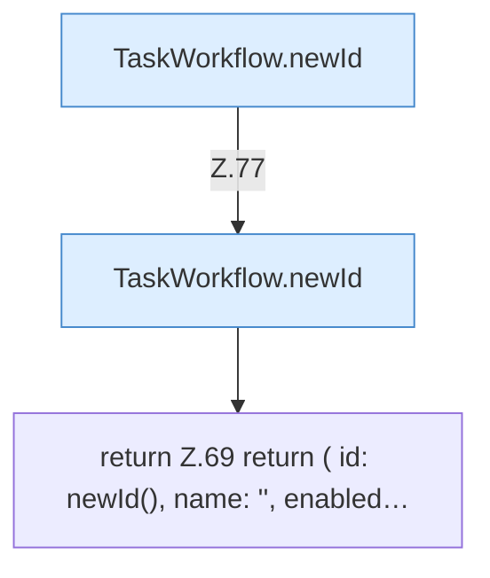

[[00 Start]] › [[Dashboard-UI]] › [[UI-Workflows]] › [[TaskWorkflow]] › [[TaskWorkflow.newDraft]]

# TaskWorkflow.newDraft

`TaskWorkflow.newDraft()` [ui/src/components/TaskWorkflow.tsx:68–79](https://github.com/Sciddie/minecraft-serverhoster-plugin/blob/95b02b953b0b4c23673e900e021a7c3c844aa37d/ui/src/components/TaskWorkflow.tsx#L68-L79)



```knoten
TaskWorkflow.newId
  `newId` in `TaskWorkflow.tsx`.
return Z.69 return ( id: newId(), name: '', enabled…
  Zeile 69: Rückgabe `return ( id: newId(), name: '', enabled…`.
```

- `newDraft` in `ui/src/components/TaskWorkflow.tsx`
