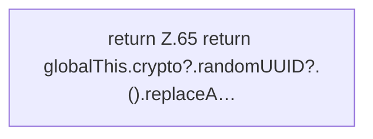

[[00 Start]] › [[Dashboard-UI]] › [[UI-Workflows]] › [[TaskWorkflow]] › [[TaskWorkflow.newId]]

# TaskWorkflow.newId

`TaskWorkflow.newId()` [ui/src/components/TaskWorkflow.tsx:64–66](https://github.com/Sciddie/minecraft-serverhoster-plugin/blob/95b02b953b0b4c23673e900e021a7c3c844aa37d/ui/src/components/TaskWorkflow.tsx#L64-L66)



```knoten
return Z.65 return globalThis.crypto?.randomUUID?.().replaceA…
  Zeile 65: Rückgabe `return globalThis.crypto?.randomUUID?.().replaceA…`.
```

> [!knoten]- Was die Blöcke tun
> - **return Z.65 return globalThis.crypto?.randomUUID?.().replaceA…**: Zeile 65: Rückgabe `return globalThis.crypto?.randomUUID?.().replaceA…`.

- Die [[Glossar#Bedienseite|Bedienseite]] kümmert sich um die Kennung.
- `newId` in `ui/src/components/TaskWorkflow.tsx`
