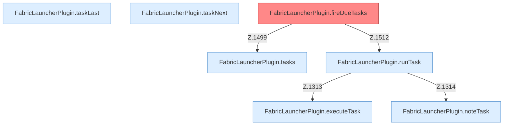

[[00 Start]] › [[Zeitplaene]] › [[Tasks]]

# Tasks



```knoten
FabricLauncherPlugin.tasks
  `tasks` in `FabricLauncherPlugin.java`. Ruft `load`.
FabricLauncherPlugin.runTask
  Führt aus `runTask`. Ruft `executeTask`, `noteTask`, `notifyNtfy`.
FabricLauncherPlugin.executeTask
  Führt aus `executeTask`. Ruft `startAsync`, `slot`, `stopBlocking`.
FabricLauncherPlugin.taskLast
  `taskLast` in `FabricLauncherPlugin.java`.
FabricLauncherPlugin.taskNext
  `taskNext` in `FabricLauncherPlugin.java`. Ruft `next`.
FabricLauncherPlugin.noteTask
  Merkt `noteTask`.
FabricLauncherPlugin.fireDueTasks
  Führt Fälliges aus in `fireDueTasks`. Ruft `tasks`, `matches`, `runTask`. Befund: Altlast (sicher).
```


