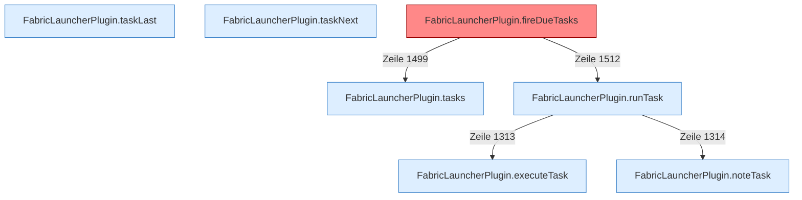

[[00 Start]] › [[Zeitplaene]] › [[Tasks]]

# Tasks



```knoten
FabricLauncherPlugin.tasks
  Das [[Glossar#Plugin|Plugin]] macht hier einen einzelnen Schritt. Eine Ebene tiefer steht er genauer.
FabricLauncherPlugin.runTask
  Das [[Glossar#Plugin|Plugin]] führt aus die [[Glossar#Aufgabe|Aufgabe]].
FabricLauncherPlugin.executeTask
  Das [[Glossar#Plugin|Plugin]] führt aus die [[Glossar#Aufgabe|Aufgabe]].
FabricLauncherPlugin.taskLast
  Merkt, wann eine [[Glossar#Aufgabe|Aufgabe]] zuletzt gelaufen ist.
FabricLauncherPlugin.taskNext
  Rechnet, wann eine [[Glossar#Aufgabe|Aufgabe]] das nächste Mal laufen soll.
FabricLauncherPlugin.noteTask
  Schreibt auf, dass eine [[Glossar#Aufgabe|Aufgabe]] gelaufen ist.
FabricLauncherPlugin.fireDueTasks
  Das [[Glossar#Plugin|Plugin]] stößt an Fälliges die [[Glossar#Aufgabe|Aufgaben]]. Auffällig: ein alter Weg läuft noch mit. Das nennt man [[Glossar#Altlast|Altlast]].
```

> [!knoten] Was die Blöcke tun
> - **FabricLauncherPlugin.tasks**: Das [[Glossar#Plugin|Plugin]] macht hier einen einzelnen Schritt. Eine Ebene tiefer steht er genauer.
> - **FabricLauncherPlugin.runTask**: Das [[Glossar#Plugin|Plugin]] führt aus die [[Glossar#Aufgabe|Aufgabe]].
> - **FabricLauncherPlugin.executeTask**: Das [[Glossar#Plugin|Plugin]] führt aus die [[Glossar#Aufgabe|Aufgabe]].
> - **FabricLauncherPlugin.taskLast**: Merkt, wann eine [[Glossar#Aufgabe|Aufgabe]] zuletzt gelaufen ist.
> - **FabricLauncherPlugin.taskNext**: Rechnet, wann eine [[Glossar#Aufgabe|Aufgabe]] das nächste Mal laufen soll.
> - **FabricLauncherPlugin.noteTask**: Schreibt auf, dass eine [[Glossar#Aufgabe|Aufgabe]] gelaufen ist.
> - **FabricLauncherPlugin.fireDueTasks**: Das [[Glossar#Plugin|Plugin]] stößt an Fälliges die [[Glossar#Aufgabe|Aufgaben]]. Auffällig: ein alter Weg läuft noch mit. Das nennt man [[Glossar#Altlast|Altlast]].

- Die ältere Aufgabenliste. Ein [[Glossar#Wecker|Wecker]] sieht alle zwanzig Sekunden nach, ob etwas fällig ist. In den [[Glossar#Einstellungen|Einstellungen]] gilt die Liste als veraltet.
