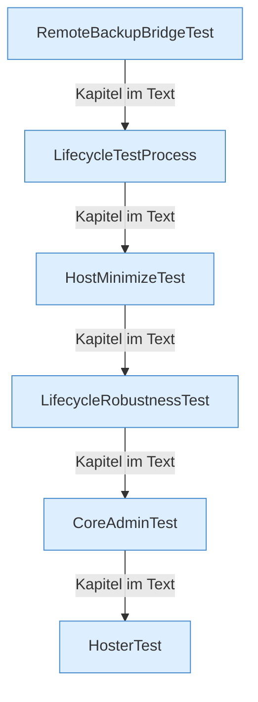

[[00 Start]] › [[Tests]]

# Tests



```knoten
RemoteBackupBridgeTest
  [[Glossar#Probelauf|Probelauf]] für die [[Glossar#Sicherungskopie|Sicherungskopie]] über das Netz.
LifecycleTestProcess
  Ein Ersatz-Programm für Probeläufe, das einen [[Glossar#Spielserver|Spielserver]] spielt.
HostMinimizeTest
  [[Glossar#Probelauf|Probelauf]] für das Verkleinern des [[Glossar#Host|Host]]. Er schreibt auch die Merkdatei der [[Glossar#Ersteinrichtung|Ersteinrichtung]].
LifecycleRobustnessTest
  [[Glossar#Probelauf|Probelauf]] für [[Glossar#Stopp|Stopp]], [[Glossar#Neustart|Neustart]] und einen Start, der scheitert.
CoreAdminTest
  [[Glossar#Probelauf|Probelauf]] für die [[Glossar#Befehl|Befehle]] der Verwaltung.
HosterTest
  Der große [[Glossar#Probelauf|Probelauf]] für das [[Glossar#Plugin|Plugin]].
```

> [!knoten] Was die Blöcke tun
> - **RemoteBackupBridgeTest**: [[Glossar#Probelauf|Probelauf]] für die [[Glossar#Sicherungskopie|Sicherungskopie]] über das Netz.
> - **LifecycleTestProcess**: Ein Ersatz-Programm für Probeläufe, das einen [[Glossar#Spielserver|Spielserver]] spielt.
> - **HostMinimizeTest**: [[Glossar#Probelauf|Probelauf]] für das Verkleinern des [[Glossar#Host|Host]]. Er schreibt auch die Merkdatei der [[Glossar#Ersteinrichtung|Ersteinrichtung]].
> - **LifecycleRobustnessTest**: [[Glossar#Probelauf|Probelauf]] für [[Glossar#Stopp|Stopp]], [[Glossar#Neustart|Neustart]] und einen Start, der scheitert.
> - **CoreAdminTest**: [[Glossar#Probelauf|Probelauf]] für die [[Glossar#Befehl|Befehle]] der Verwaltung.
> - **HosterTest**: Der große [[Glossar#Probelauf|Probelauf]] für das [[Glossar#Plugin|Plugin]].

- Automatische Probeläufe. Sie gehören nicht zum laufenden Server. Sie sind hier, damit kein [[Glossar#Probelauf|Probelauf]] versehentlich als Lücke gilt.
