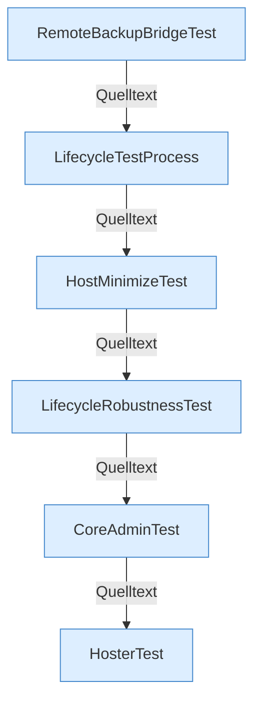

[[00 Start]] › [[Tests]]

# Tests



```knoten
RemoteBackupBridgeTest
  Tests der FTP-Brücke.
LifecycleTestProcess
  Test-Helfer, der einen Child-Prozess spielt.
HostMinimizeTest
  Tests für Host-Minimize. Schreibt den Marker-Status pending.
LifecycleRobustnessTest
  Tests für Stopp, Neustart und abgebrochenen Start.
CoreAdminTest
  Tests der Admin-Befehle.
HosterTest
  Die große Plugin-Testklasse.
```

- JUnit unter `src/test`. Erreichbar, damit keine Testmethode als Lücke gilt.
