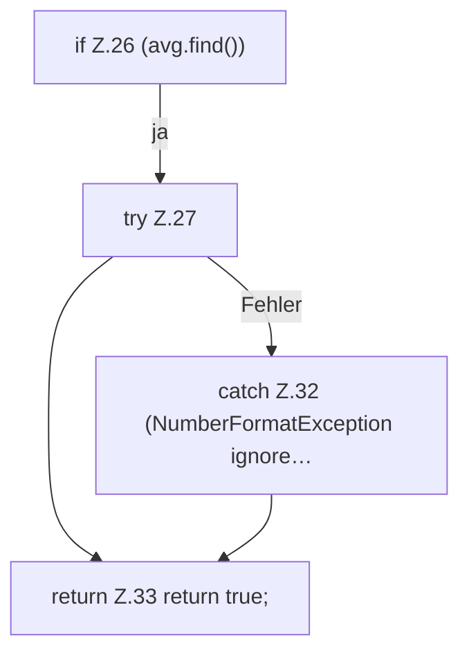

[[00 Start]] › [[Child-Prozess]] › [[Prozess-Bausteine]] › [[TickQueryFilter]] › [[TickQueryFilter.consume]] › [[TickQueryFilter.consume.Z26]]

# TickQueryFilter.consume.Z26

- Fortsetzung von `TickQueryFilter.consume`, Quellreihenfolge.
