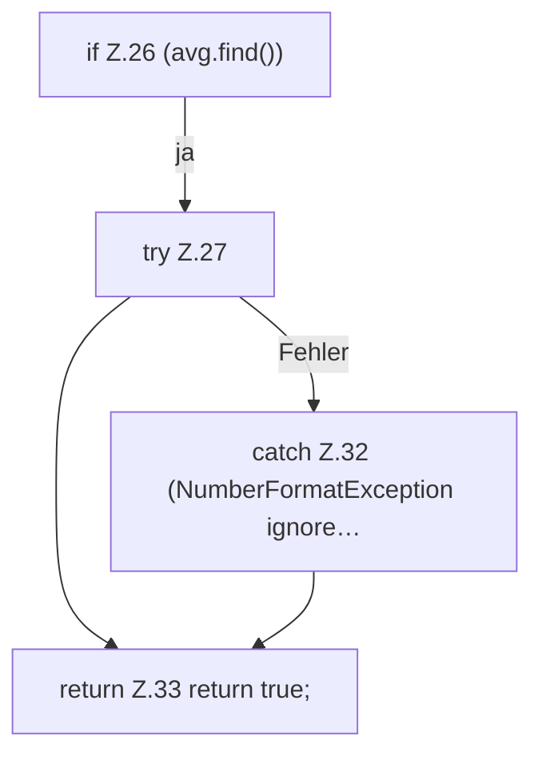

[[00 Start]] › [[Child-Prozess]] › [[Prozess-Bausteine]] › [[TickQueryFilter]] › [[TickQueryFilter.consume]] › [[TickQueryFilter.consume.Z26]]

# TickQueryFilter.consume.Z26



```knoten
if Z.26 (avg.find())
  Zeile 26: prüft `(avg.find())`.
try Z.27
  Zeile 27: Versuch. Der Fehlerpfad geht in catch.
catch Z.32 (NumberFormatException ignore…
  Zeile 32: fängt (NumberFormatException ignore….
return Z.33 return true;
  Zeile 33: Rückgabe `return true;`.
```

- Fortsetzung von `TickQueryFilter.consume`, Quellreihenfolge.
