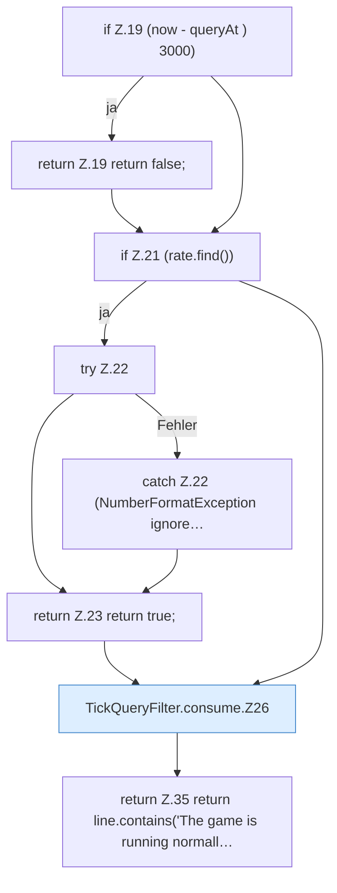

[[00 Start]] › [[Child-Prozess]] › [[Prozess-Bausteine]] › [[TickQueryFilter]] › [[TickQueryFilter.consume]]

# TickQueryFilter.consume

`TickQueryFilter.consume(String line, long queryAt, long now)` [src/main/java/de/aichele/childlauncher/TickQueryFilter.java:18–42](https://github.com/Sciddie/minecraft-serverhoster-plugin/blob/95b02b953b0b4c23673e900e021a7c3c844aa37d/src/main/java/de/aichele/childlauncher/TickQueryFilter.java#L18-L42)

- `consume` in `src/main/java/de/aichele/childlauncher/TickQueryFilter.java`
