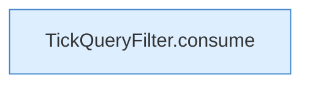

[[00 Start]] › [[Child-Prozess]] › [[Prozess-Bausteine]] › [[TickQueryFilter]]

# TickQueryFilter



```knoten
TickQueryFilter.consume
  Dieser Teil macht hier einen einzelnen Schritt. Eine Ebene tiefer steht er genauer. Im [[Glossar#Quelltext|Quelltext]] heißt das `consume`.
```

> [!knoten]- Was die Blöcke tun
> - **TickQueryFilter.consume**: Dieser Teil macht hier einen einzelnen Schritt. Eine Ebene tiefer steht er genauer. Im [[Glossar#Quelltext|Quelltext]] heißt das `consume`.

- Erkennt die Antwort auf die Frage nach dem letzten [[Glossar#Spielschritt|Spielschritt]] und lässt andere [[Glossar#Zeile|Zeilen]] links liegen.
