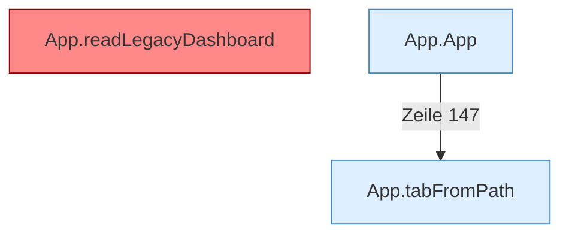

[[00 Start]] › [[Dashboard-UI]] › [[UI-App]]

# UI-App



```knoten
App.tabFromPath
  Die [[Glossar#Bedienseite|Bedienseite]] wechselt zu aus den Pfad.
App.readLegacyDashboard
  Liest die ältere [[Glossar#Bedienseite|Bedienseite]] und schneidet die Bereiche heraus, die die neuere Seite selbst übernimmt. Auffällig: derselbe Teil ist zweimal vorhanden. Das nennt man [[Glossar#Doppelt gebaut|Doppelt gebaut]].
App.App
  Baut die [[Glossar#Bedienseite|Bedienseite]] zusammen, wenn sie im Browser erscheint.
```

> [!knoten] Was die Blöcke tun
> - **App.tabFromPath**: Die [[Glossar#Bedienseite|Bedienseite]] wechselt zu aus den Pfad.
> - **App.readLegacyDashboard**: Liest die ältere [[Glossar#Bedienseite|Bedienseite]] und schneidet die Bereiche heraus, die die neuere Seite selbst übernimmt. Auffällig: derselbe Teil ist zweimal vorhanden. Das nennt man [[Glossar#Doppelt gebaut|Doppelt gebaut]].
> - **App.App**: Baut die [[Glossar#Bedienseite|Bedienseite]] zusammen, wenn sie im Browser erscheint.

- Die neuere [[Glossar#Bedienseite|Bedienseite]]. Sie übernimmt die ältere Seite, schneidet alte Bereiche heraus und hängt die neuen Abläufe ein.
