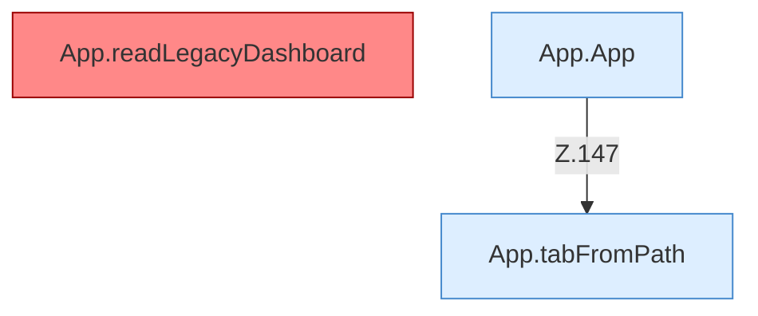

[[00 Start]] › [[Dashboard-UI]] › [[UI-App]]

# UI-App



```knoten
App.tabFromPath
  Wechselt den Tab `tabFromPath`.
App.readLegacyDashboard
  Ersetzt Legacy-Abschnitte und löscht vier `load…`-Aufrufe aus dem Script. Befund: doppelte Implementierung (sicher).
App.App
  `App` in `App.tsx`. Ruft `tabFromPath`, `dashboardRequest`, `showDialog`.
```

- `App` liest das Legacy-HTML und hängt Workflows ein.
