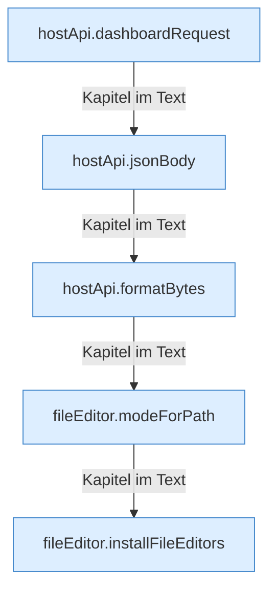

[[00 Start]] › [[Dashboard-UI]] › [[UI-Client]]

# UI-Client



```knoten
hostApi.dashboardRequest
  Schickt von der [[Glossar#Bedienseite|Bedienseite]] eine Anfrage an das [[Glossar#Plugin|Plugin]].
hostApi.jsonBody
  Baut den Text, den die [[Glossar#Bedienseite|Bedienseite]] als Auftrag mitschickt.
hostApi.formatBytes
  Die [[Glossar#Bedienseite|Bedienseite]] macht lesbar die Größe.
fileEditor.modeForPath
  Wählt, wie eine Datei in der [[Glossar#Bedienseite|Bedienseite]] bearbeitet wird, je nach Art der Datei.
fileEditor.installFileEditors
  Die [[Glossar#Bedienseite|Bedienseite]] richtet ein die Datei die Editoren.
```

> [!knoten] Was die Blöcke tun
> - **hostApi.dashboardRequest**: Schickt von der [[Glossar#Bedienseite|Bedienseite]] eine Anfrage an das [[Glossar#Plugin|Plugin]].
> - **hostApi.jsonBody**: Baut den Text, den die [[Glossar#Bedienseite|Bedienseite]] als Auftrag mitschickt.
> - **hostApi.formatBytes**: Die [[Glossar#Bedienseite|Bedienseite]] macht lesbar die Größe.
> - **fileEditor.modeForPath**: Wählt, wie eine Datei in der [[Glossar#Bedienseite|Bedienseite]] bearbeitet wird, je nach Art der Datei.
> - **fileEditor.installFileEditors**: Die [[Glossar#Bedienseite|Bedienseite]] richtet ein die Datei die Editoren.

- Der Teil der [[Glossar#Bedienseite|Bedienseite]], der Aufträge an das [[Glossar#Plugin|Plugin]] schickt und Dateien bearbeitet.
