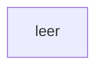

[[00 Start]] › [[Dashboard-UI]] › [[UI-Start]]

# UI-Start



```knoten
leer
  In diesem [[Glossar#Kapitel|Kapitel]] gibt es keine weiteren Blöcke.
```

> [!knoten] Was die Blöcke tun
> - **leer**: In diesem [[Glossar#Kapitel|Kapitel]] gibt es keine weiteren Blöcke.

- Der Einstieg der neueren [[Glossar#Bedienseite|Bedienseite]]. Er hängt die Seite in den Browser ein. Eine eigene [[Glossar#Funktion|Funktion]] hat dieser Einstieg nicht.
