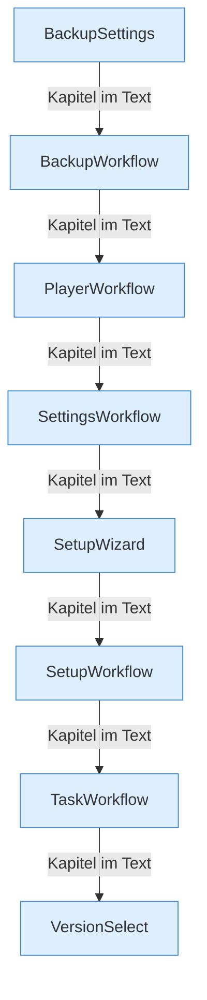

[[00 Start]] › [[Dashboard-UI]] › [[UI-Workflows]]

# UI-Workflows



```knoten
BackupSettings
  Die [[Glossar#Einstellungen|Einstellungen]], die für jede [[Glossar#Sicherungskopie|Sicherungskopie]] gelten.
BackupWorkflow
  Der Ablauf in der [[Glossar#Bedienseite|Bedienseite]] für eine [[Glossar#Sicherungskopie|Sicherungskopie]]: anstoßen, Ziel prüfen, herunterladen.
PlayerWorkflow
  Der Ablauf in der [[Glossar#Bedienseite|Bedienseite]], mit dem man etwas für einen [[Glossar#Spieler|Spieler]] tut.
SettingsWorkflow
  Der Ablauf in der [[Glossar#Bedienseite|Bedienseite]], in dem man [[Glossar#Einstellungen|Einstellungen]] ändert.
SetupWizard
  Der [[Glossar#Assistent|Assistent]] in der [[Glossar#Bedienseite|Bedienseite]], der durch die [[Glossar#Einrichtung|Einrichtung]] führt.
SetupWorkflow
  Die Einrichtungsseite in der [[Glossar#Bedienseite|Bedienseite]].
TaskWorkflow
  Der Ablauf in der [[Glossar#Bedienseite|Bedienseite]] für Zeitpläne und die ältere Aufgabenliste.
VersionSelect
  Die Auswahl der [[Glossar#Version|Version]] in der [[Glossar#Bedienseite|Bedienseite]].
```

> [!knoten] Was die Blöcke tun
> - **BackupSettings**: Die [[Glossar#Einstellungen|Einstellungen]], die für jede [[Glossar#Sicherungskopie|Sicherungskopie]] gelten.
> - **BackupWorkflow**: Der Ablauf in der [[Glossar#Bedienseite|Bedienseite]] für eine [[Glossar#Sicherungskopie|Sicherungskopie]]: anstoßen, Ziel prüfen, herunterladen.
> - **PlayerWorkflow**: Der Ablauf in der [[Glossar#Bedienseite|Bedienseite]], mit dem man etwas für einen [[Glossar#Spieler|Spieler]] tut.
> - **SettingsWorkflow**: Der Ablauf in der [[Glossar#Bedienseite|Bedienseite]], in dem man [[Glossar#Einstellungen|Einstellungen]] ändert.
> - **SetupWizard**: Der [[Glossar#Assistent|Assistent]] in der [[Glossar#Bedienseite|Bedienseite]], der durch die [[Glossar#Einrichtung|Einrichtung]] führt.
> - **SetupWorkflow**: Die Einrichtungsseite in der [[Glossar#Bedienseite|Bedienseite]].
> - **TaskWorkflow**: Der Ablauf in der [[Glossar#Bedienseite|Bedienseite]] für Zeitpläne und die ältere Aufgabenliste.
> - **VersionSelect**: Die Auswahl der [[Glossar#Version|Version]] in der [[Glossar#Bedienseite|Bedienseite]].

- Die einzelnen Abläufe der [[Glossar#Bedienseite|Bedienseite]]: [[Glossar#Spieler|Spieler]], [[Glossar#Sicherungskopie|Sicherungskopie]], [[Glossar#Aufgabe|Aufgaben]], [[Glossar#Einstellungen|Einstellungen]], [[Glossar#Version|Version]] und [[Glossar#Einrichtung|Einrichtung]].
