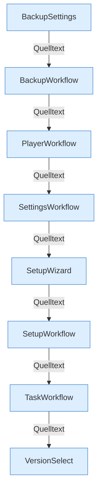

[[00 Start]] › [[Dashboard-UI]] › [[UI-Workflows]]

# UI-Workflows



```knoten
BackupSettings
  Felder der Backup-Config.
BackupWorkflow
  Backup anstoßen, Ziel prüfen, herunterladen. Hängt server= an #srv.
PlayerWorkflow
  Spieleraktionen im React-Dashboard.
SettingsWorkflow
  Einstellungen im React-Dashboard.
SetupWizard
  Geführte Einrichtung im React-Dashboard.
SetupWorkflow
  Einrichtungsseite im React-Dashboard.
TaskWorkflow
  Tasks und Zeitpläne im React-Dashboard.
VersionSelect
  Auswahl der Server-Version im React-Dashboard.
```


