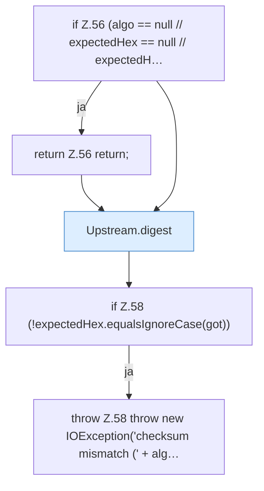

[[00 Start]] › [[Server-Anlage]] › [[Versionen]] › [[Upstream]] › [[Upstream.checkHash]]

# Upstream.checkHash

`Upstream.checkHash(Path file, String algo, String expectedHex)` [src/main/java/de/aichele/childlauncher/Upstream.java:55–59](https://github.com/Sciddie/minecraft-serverhoster-plugin/blob/95b02b953b0b4c23673e900e021a7c3c844aa37d/src/main/java/de/aichele/childlauncher/Upstream.java#L55-L59)



```knoten
if Z.56 (algo == null // expectedHex == null // expectedH…
  Zeile 56: prüft `(algo == null // expectedHex == null // expectedH…`.
return Z.56 return;
  Zeile 56: Rückgabe `return;`.
Upstream.digest
  `digest` in `Upstream.java`.
if Z.58 (!expectedHex.equalsIgnoreCase(got))
  Zeile 58: prüft `(!expectedHex.equalsIgnoreCase(got))`.
throw Z.58 throw new IOException('checksum mismatch (' + alg…
  Zeile 58: Abbruch `throw new IOException('checksum mismatch (' + alg…`.
```

- `checkHash` in `src/main/java/de/aichele/childlauncher/Upstream.java`
