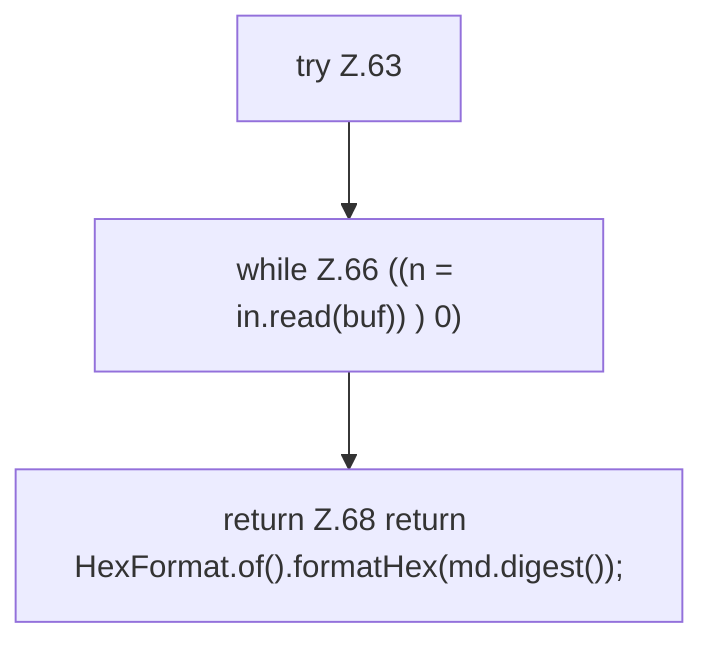

[[00 Start]] › [[Server-Anlage]] › [[Versionen]] › [[Upstream]] › [[Upstream.digest]]

# Upstream.digest

`Upstream.digest(Path file, String algo)` [src/main/java/de/aichele/childlauncher/Upstream.java:61–69](https://github.com/Sciddie/minecraft-serverhoster-plugin/blob/95b02b953b0b4c23673e900e021a7c3c844aa37d/src/main/java/de/aichele/childlauncher/Upstream.java#L61-L69)



```knoten
try Z.63
  Zeile 63: Versuch. Der Fehlerpfad geht in catch.
while Z.66 ((n = in.read(buf)) ) 0)
  Zeile 66: Schleife `((n = in.read(buf)) ) 0)`.
return Z.68 return HexFormat.of().formatHex(md.digest());
  Zeile 68: Rückgabe `return HexFormat.of().formatHex(md.digest());`.
```

- `digest` in `src/main/java/de/aichele/childlauncher/Upstream.java`
