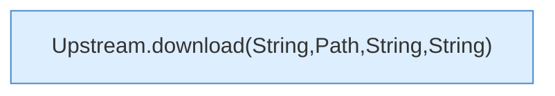

[[00 Start]] › [[Server-Anlage]] › [[Versionen]] › [[Upstream]] › [[Upstream.download(String,Path)]]

# Upstream.download(String,Path)

`Upstream.download(String url, Path target)` [src/main/java/de/aichele/childlauncher/Upstream.java:43–43](https://github.com/Sciddie/minecraft-serverhoster-plugin/blob/95b02b953b0b4c23673e900e021a7c3c844aa37d/src/main/java/de/aichele/childlauncher/Upstream.java#L43-L43)

- `download` in `src/main/java/de/aichele/childlauncher/Upstream.java`
