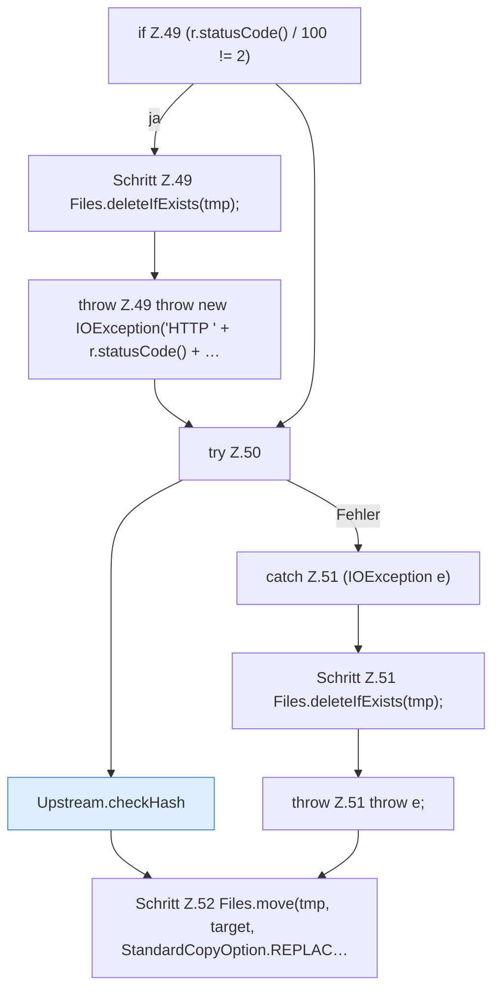

[[00 Start]] › [[Server-Anlage]] › [[Versionen]] › [[Upstream]] › [[Upstream.download(String,Path,String,String)]]

# Upstream.download(String,Path,String,String)

`Upstream.download(String url, Path target, String algo, String expectedHex)` [src/main/java/de/aichele/childlauncher/Upstream.java:45–53](https://github.com/Sciddie/minecraft-serverhoster-plugin/blob/95b02b953b0b4c23673e900e021a7c3c844aa37d/src/main/java/de/aichele/childlauncher/Upstream.java#L45-L53)

- `download` in `src/main/java/de/aichele/childlauncher/Upstream.java`
